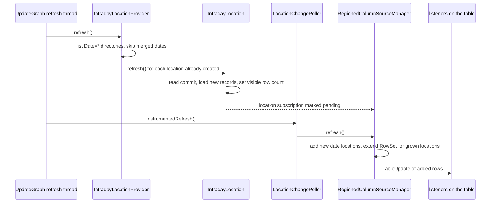

# How `db.t` and `db.i` work

`db.t` and `db.i` are two readers over one catalog. They never see the same bytes for a given date.

- `db.t(namespace, table)` reads the historical store. That store is static Parquet, partitioned by `Date`.
- `db.i(namespace, table)` tails the intraday store. That store is one append-only log per date. A live call keeps growing. A snapshot call reads the log once.

A date moves from the intraday reader to the historical reader when `db.merge` copies that date's log into Parquet and marks the log merged. Until that happens, `db.t` does not contain the date. After that happens, a new `db.i` call does not contain it.

The Groovy name `db` is the shared `Database` instance. On session startup, `DatabaseInitScript` loads `groovy/1-db.groovy`, which runs:

```groovy
db = io.deephaven.db.Database.shared()
```

`Database.shared()` opens the directory in the `Database.root` configuration property. The default directory is `data/deephaven-db`.

## On-disk layout

```
<root>/
  catalog/<namespace>/<table>.schema
  historical/<namespace>/<table>/Date=<date>/*.parquet
  intraday/<namespace>/<table>/writer.lock
  intraday/<namespace>/<table>/Date=<date>/log
  intraday/<namespace>/<table>/Date=<date>/commit
  intraday/<namespace>/<table>/Date=<date>/merged
```

`catalog/<namespace>/<table>.schema` is the table's contract. Both readers refuse the call when this file is missing. The file is text. Line 1 is the version (`1`). Each later line is `name<TAB>java-type<TAB>partition|normal`. `Date` is the partitioning column and is always a `String`.

`add` and `append` create the schema from the first write and reject a later write whose column names or types differ.

Namespace and table names must match `[A-Za-z_][A-Za-z0-9_]*`. A date partition must be non-empty and must not contain `/`, `\`, or `=`. Those checks keep a name from escaping its directory.

## `db.t`: static historical Parquet

`Database.t` loads the schema, then looks at `historical/<namespace>/<table>`.

When that directory does not exist, `t` returns an empty in-memory table with the catalog schema. An intraday-only table therefore looks empty through `t`.

When the directory exists, `t` calls `ParquetTools.readTable` with two instructions:

- file layout `KV_PARTITIONED`, so each `Date=<date>` child is one partition
- table definition taken from the catalog schema, so the Parquet reader does not infer a schema from whichever file it happens to open first

The result is a static `PartitionAwareSourceTable` backed by Parquet column regions. It is not registered with the `UpdateGraph`. A later `add` or `merge` writes new files, but a table already returned by `t` does not pick them up. Call `t` again to see the new files.

`Date` is a partitioning column. A filter such as `where("Date=\`2024-01-01\`")` drops other `Date=` directories before those files are read. That is the engine's normal partition pushdown on a `PartitionAwareSourceTable`, not a special path inside `Database`.

Historical files are produced by `add` and by `merge`. Both call `ParquetTools.writeKeyValuePartitionedTable`, which writes one `Date=<date>` directory per distinct date in the source. `add` writes straight into the historical directory. `merge` writes into a sibling staging directory and atomically moves each finished `Date=` directory into place, so a reader never sees a half-written partition.

## `db.i`: one log per date

`Database.i(namespace, table)` is `i(namespace, table, true)`. The third argument chooses a live tail or a one-shot snapshot.

Both forms build the same objects:

1. An `IntradayLocationProvider` rooted at `intraday/<namespace>/<table>`, with the historical directory passed in so merged dates can be hidden.
2. A `PartitionAwareSourceTable` whose component factory is `RegionedTableComponentFactoryImpl`. The table definition comes from the catalog schema.

The live form passes the current `ExecutionContext` `UpdateGraph` into that source table and declares both the table and its locations `APPEND_ONLY`. The snapshot form passes a null registrar and declares both `STATIC`.

Live calls are cached on the `Database` instance, keyed by `namespace/table`. A second live call returns the same table object. Snapshot calls are not cached. `merge` drops the cache entry, so the next live call builds a new table that no longer lists the merged date. A table returned before that `merge` keeps the locations it already had. The provider never removes a location, because the location update mode is append-only.

### Which dates are visible

On each refresh the provider lists `intraday/<namespace>/<table>/Date=*` and skips a directory when either of these is true:

- the directory contains a `merged` file
- `historical/<namespace>/<table>/Date=<date>` already exists

Each remaining directory becomes one `DateLocationKey` and therefore one `IntradayLocation`. One date is one table location. The engine then maps each location to one region in the row-key address space (`RegionedColumnSource`: 20 bits of region index, the rest of the positive `long` for the row inside that date).

`Date` is not stored in the log payload. `IntradayColumnLocation` fills that column from the directory name.

### The log and the commit file

`IntradayLog` is the only format `db.i` trusts. Readers ignore any byte past the length recorded in `commit`.

`log` starts with the 8-byte magic `DHIDBLOG`. Each record is:

| Field | Width | Meaning |
| --- | --- | --- |
| magic | 4 bytes | `0x31424449` |
| row count | 4 bytes | rows in this record |
| payload length | 4 bytes | bytes of Parquet that follow |
| checksum | 4 bytes | CRC32 of the payload |
| payload | `payload length` | one Parquet file for the data columns, without `Date` |

`commit` is `DHCOMMIT`, then the committed byte length (`long`), the committed row count (`long`), and a CRC32 of those two longs. A writer fills `commit.tmp`, forces it, and atomically renames it onto `commit`. A crash in the middle of a payload leaves extra bytes on `log` and leaves `commit` unchanged. The next `append` truncates `log` back to the committed length before writing the next record. `IntradayLogTest` covers that torn tail.

`append` is what grows a log. It snapshots the source table, splits it by `Date`, and for each date writes the data columns to a temporary Parquet file, reads those bytes back, and appends one record. An append to a date that is already merged, or that already has a historical directory, throws.

Writers take two locks. An interned Java monitor per namespace and table serializes writers inside this process. `TableWriterLock` then holds an exclusive `FileLock` on `intraday/<namespace>/<table>/writer.lock` for the life of the `Database` object. A second process that tries to write the same table fails with `IllegalStateException`. Readers of `t` and `i` do not take that lock. They race the writer only up to the atomic commit rename.

### From a commit to table rows

`IntradayLocation.pull` is the tail.

1. Read `commit`.
2. Walk `log` up to the committed length and check that the record boundaries and the summed row count match the commit. A mismatch throws.
3. For each record this location has not loaded yet, read the payload and keep it as a `Batch` `(startRow, rowCount, parquetBytes)`. A commit that shrinks the record list throws. The location does not support deletes or replacements.
4. Publish `RowSetFactory.flat(commit.rowCount)` through `AbstractTableLocation.handleUpdate`.

The first pull also runs the location's one-time `initializeState`. Later pulls only append batches and, when the flat row-set size changed, notify subscribers.

A `Batch` stays compressed until something reads a column. The first read writes the bytes to a temp file, opens them with `ParquetTools.readTable`, snapshots that into an in-memory table, and deletes the temp file. Later reads of the same batch use that in-memory table.

Column values are not read straight from those batches by query code. `IntradayColumnLocation` installs an `AppendOnlyFixedSizePageRegion*` (page size 65,536) for the column's primitive or object type. The region asks its accessor for a page suffix. The accessor's size is `visibleRows`, which is the committed row count. For each requested row the accessor binary-searches the batch list, then copies one value from that batch's column source into the page. `Date` skips the batches and writes the location's date string. Filled pages are soft-referenced, so a page that nothing is using can be dropped and filled again.

The `visibleRows` check is what stops a reader from observing a batch the commit does not yet include. Payloads are loaded only for records inside the commit, and the page filler stops at `visibleRows`.

### What runs in the background

A live `db.i` table does not poll on its own at the moment `i` returns. The `UpdateGraph` subscription is installed when the source table coalesces. Coalesce is the first operation that needs the row set, such as `size()` or a downstream query. The test drives the same path by hand with `ControlledUpdateGraph` because unit-test mode does not start the refresh thread.

Coalesce does two registrations, in this order:

1. A `TableLocationSubscriptionBuffer` subscribes to the provider. That subscription calls `IntradayLocationProvider.activateUnderlyingDataSource`, which adds `provider.refresh` as an `UpdateGraph` source and runs it once.
2. `SourceTable` adds its `LocationChangePoller` as a second source.

After that, the `PeriodicUpdateGraph` refresh thread runs both sources on each cycle. The default target cycle is 1000 ms (`PeriodicUpdateGraph.targetCycleDurationMillis`). An `append` from the same server does not wake the graph. The new rows show up on a later cycle.

One cycle, for this table:



`provider.refresh` is the piece that actually tails the files. For every location object that already exists it calls `location.refresh()`, which runs `pull`. New `Date=` directories are reported to the provider's listeners as added location keys. They are not turned into location objects inside `discover`.

`LocationChangePoller` is the piece that turns those signals into a table update.

- It drains the provider subscription. New date keys pass the partition filter and are added to the `RegionedColumnSourceManager`. Removed keys are not expected. The provider's update mode is append-only, and a removed key fails the refresh.
- It then calls `columnSourceManager.refresh()`. Locations that already have rows are polled through a `TableLocationUpdateSubscriptionBuffer`. If the location's flat row set grew, the new row keys are shifted into that location's region and reported as added rows. Locations that were empty are included once their row set becomes non-empty. The resulting `TableUpdate` has added rows only. There are no removes, shifts, or modified columns.

The provider source is registered before the poller. A single-threaded notification processor therefore tails the logs and then publishes the row-set change in the same cycle. A concurrent processor can run the poller first. In that case the new rows wait for the next cycle. `pull` only appends, and `handleUpdate` marks the subscription only after `visibleRows` and the batch list are updated, so a poll either sees the previous commit or the new one.

A snapshot `db.i(namespace, table, false)` never subscribes. Its provider refresh runs once, from `SourceTable.initialize`, and each location is pulled once while the column-source manager computes the initial row set. Later appends leave that table unchanged. The live-versus-snapshot test in `DatabaseTest` appends two more rows and checks that the live table grows to 4 while the snapshot stays at 2.

Downstream ticking tables listen to this source the same way they listen to any other refreshing source. A `where`, `view`, or aggregation built on a live `db.i` table is in the same `UpdateGraph` and runs after the source's `TableUpdate` is delivered.

## What `t` and `i` do not do

They do not union history with the tail. A query that needs both calls `t` and `i` and merges them itself. After `merge` for a date, that date is on the `t` side only, for a newly opened `i`.

They do not watch the historical directory. `t` is a point-in-time Parquet open. `i` watches intraday commits, and it hides a date once the historical partition or the `merged` marker is present at discovery time.

They do not rewrite a table that was already handed out. A new `t` or, after `merge`, a new `i` is how a caller sees the store as it stands at that call.
